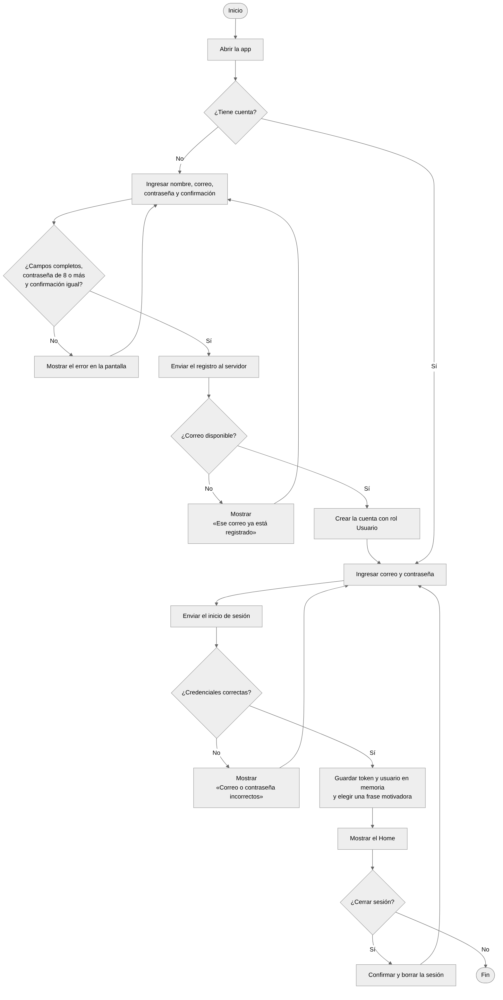
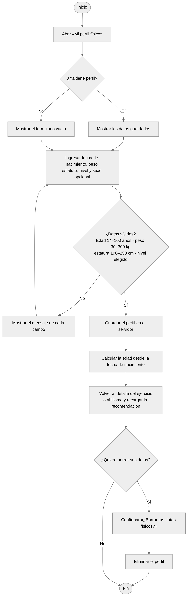
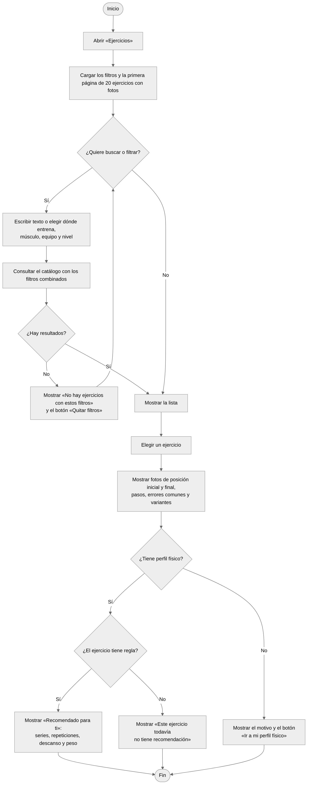
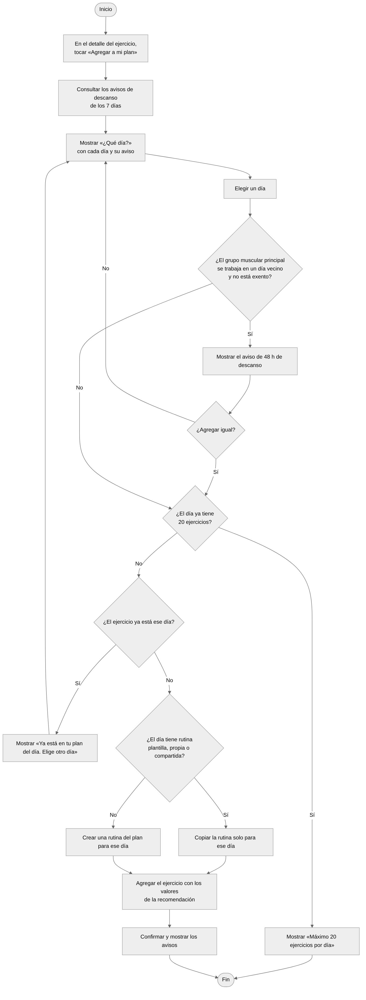
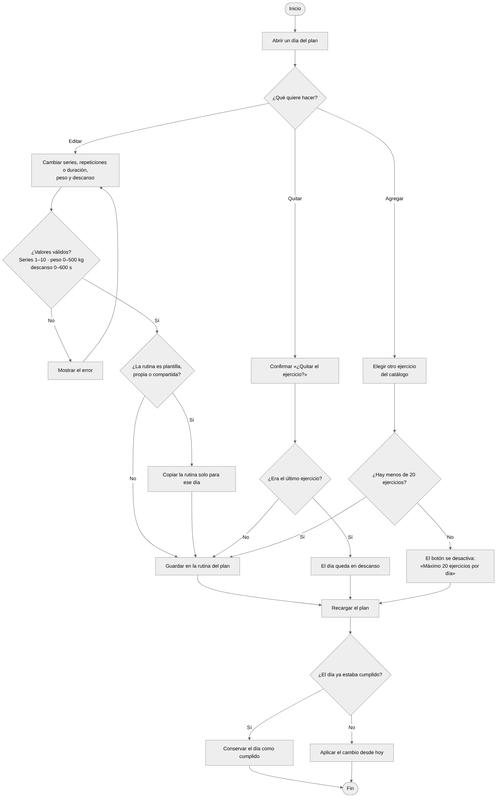
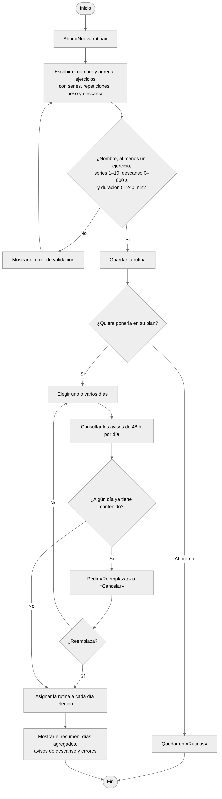
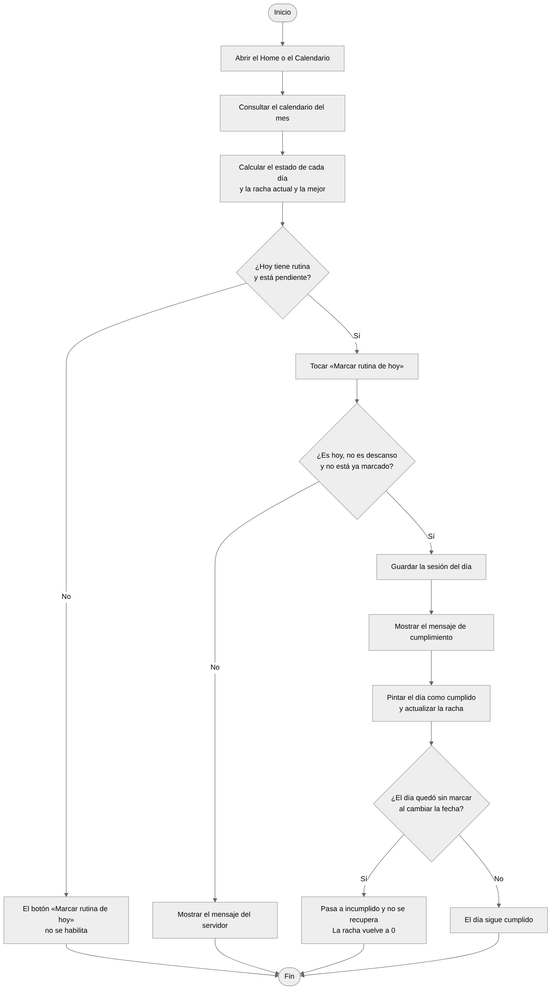
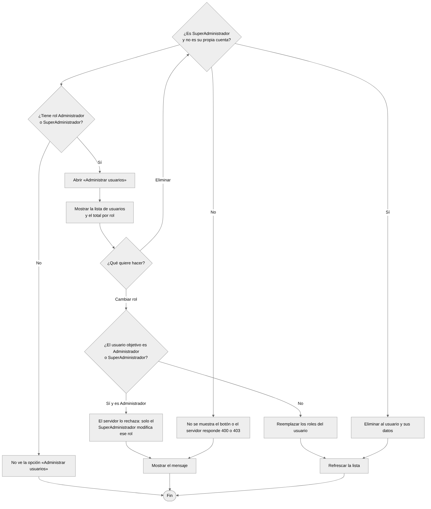

# Diagramas de actividad

Flujos de las funciones principales de PulseUp.

> Los archivos `.mmd`, `.dot` y `.bpmn` son el **código fuente** de cada diagrama (GitHub los muestra como texto). Las imágenes están aquí abajo y en los archivos `.png`.

## ACT-01 · Registro e inicio de sesión

Fuente: [`ACT-01-registro-e-inicio-de-sesion.mmd`](ACT-01-registro-e-inicio-de-sesion.mmd)

## ACT-02 · Completar el perfil físico

Fuente: [`ACT-02-completar-perfil-fisico.mmd`](ACT-02-completar-perfil-fisico.mmd)

## ACT-03 · Explorar el catálogo y ver la recomendación

Fuente: [`ACT-03-explorar-catalogo-y-ver-recomendacion.mmd`](ACT-03-explorar-catalogo-y-ver-recomendacion.mmd)

## ACT-04 · Agregar un ejercicio al plan

Fuente: [`ACT-04-agregar-ejercicio-al-plan.mmd`](ACT-04-agregar-ejercicio-al-plan.mmd)

## ACT-05 · Editar el plan del día

Fuente: [`ACT-05-editar-plan-del-dia.mmd`](ACT-05-editar-plan-del-dia.mmd)

## ACT-06 · Crear una rutina y asignarla

Fuente: [`ACT-06-crear-rutina-y-asignarla.mmd`](ACT-06-crear-rutina-y-asignarla.mmd)

## ACT-07 · Marcar el día y la racha

Fuente: [`ACT-07-marcar-dia-y-racha.mmd`](ACT-07-marcar-dia-y-racha.mmd)

## ACT-08 · Administrar usuarios

Fuente: [`ACT-08-administrar-usuarios.mmd`](ACT-08-administrar-usuarios.mmd)
