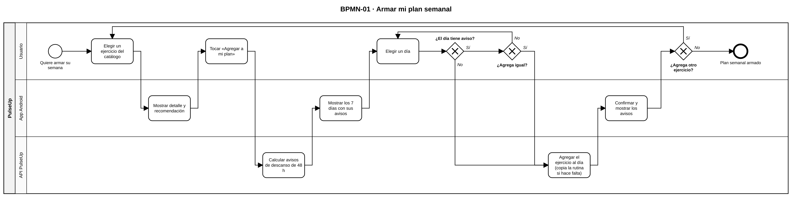
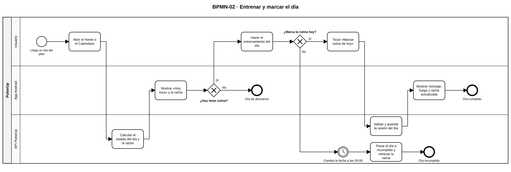

# Diagramas BPMN

Procesos de negocio de PulseUp. Los archivos `.bpmn` se pueden abrir y editar en [bpmn.io](https://demo.bpmn.io/).

> Los archivos `.mmd`, `.dot` y `.bpmn` son el **código fuente** de cada diagrama (GitHub los muestra como texto). Las imágenes están aquí abajo y en los archivos `.png`.

## BPMN-01 · Armar mi plan semanal

Fuente: [`BPMN-01-armar-plan-semanal.bpmn`](BPMN-01-armar-plan-semanal.bpmn)

## BPMN-02 · Entrenar y marcar el día

Fuente: [`BPMN-02-entrenar-y-marcar-el-dia.bpmn`](BPMN-02-entrenar-y-marcar-el-dia.bpmn)
