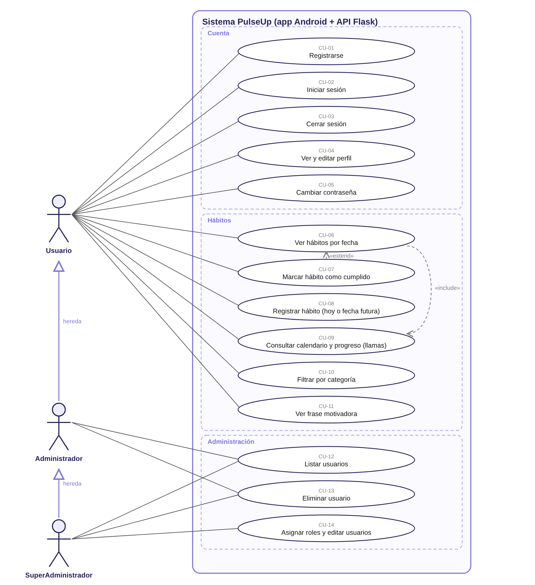

# Casos de uso

Actores y funciones actuales de PulseUp.

> Los archivos `.mmd`, `.dot` y `.bpmn` son el **código fuente** de cada diagrama (GitHub los muestra como texto). Las imágenes están aquí abajo y en los archivos `.png`.

## UC-01 · Casos de uso general

Fuente: [`UC-01-casos-de-uso-general.dot`](UC-01-casos-de-uso-general.dot)
