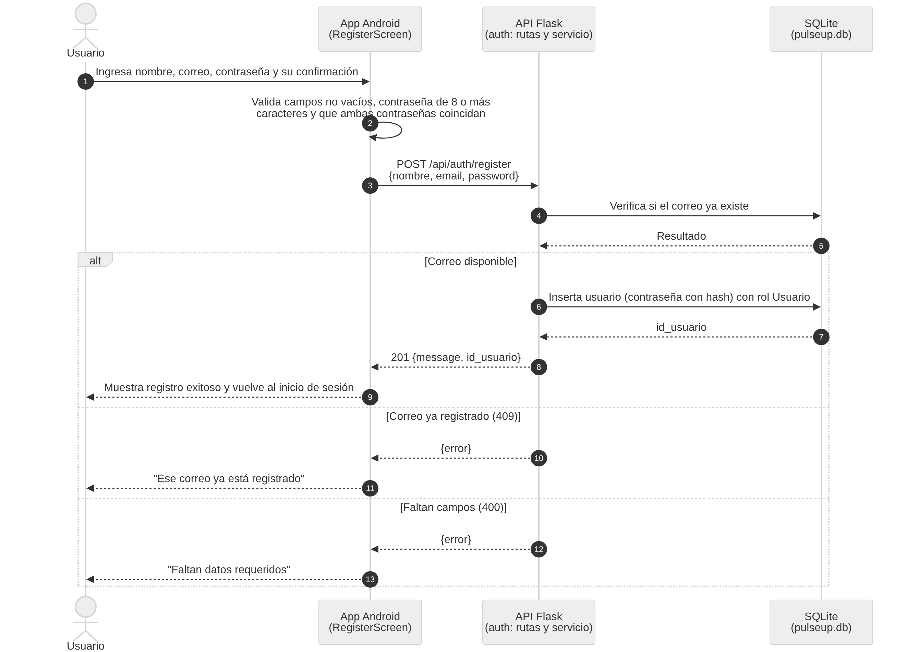
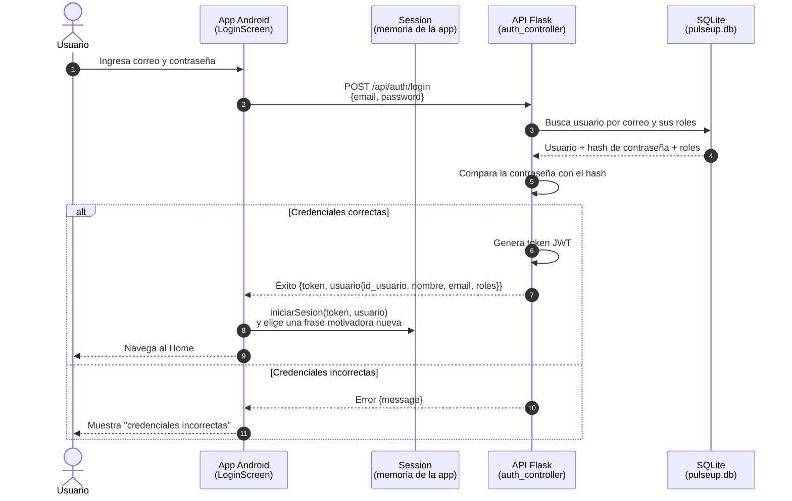
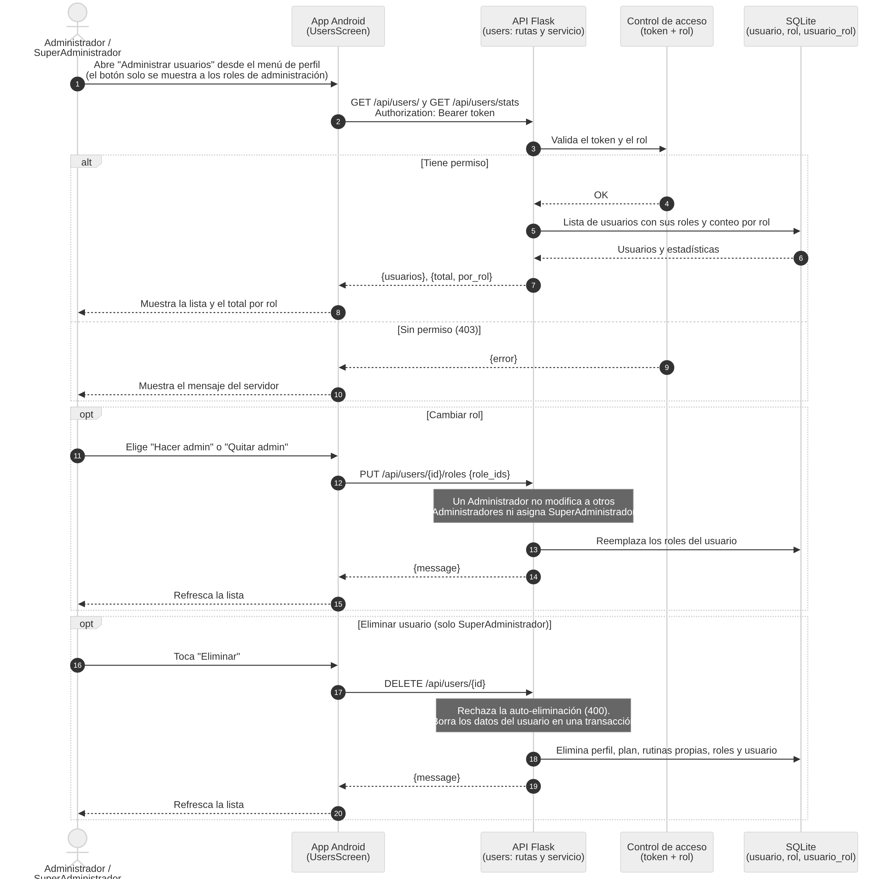
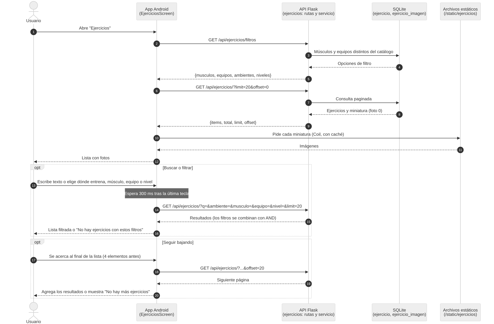
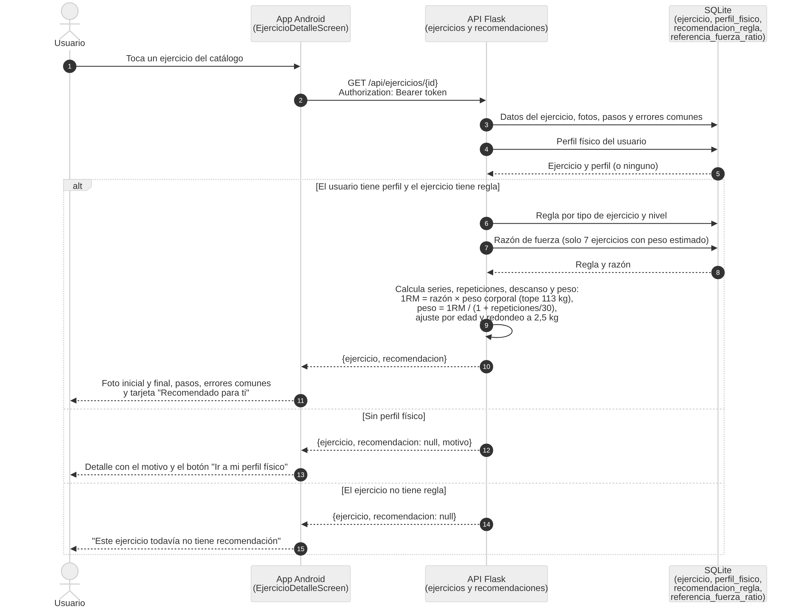
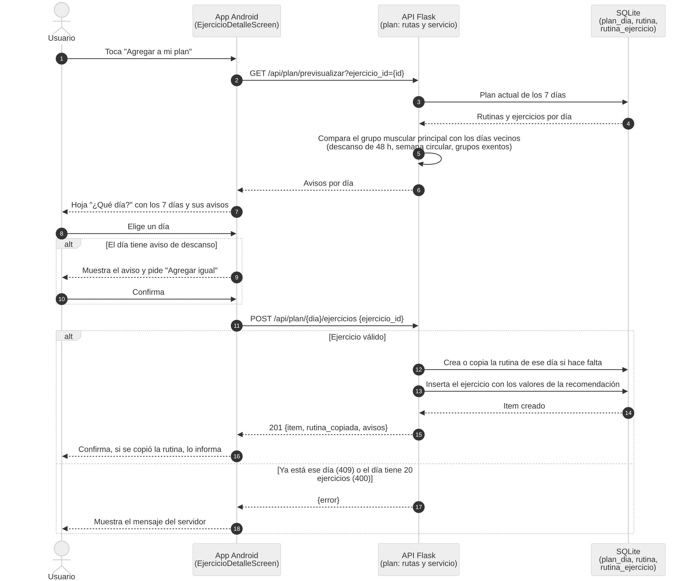
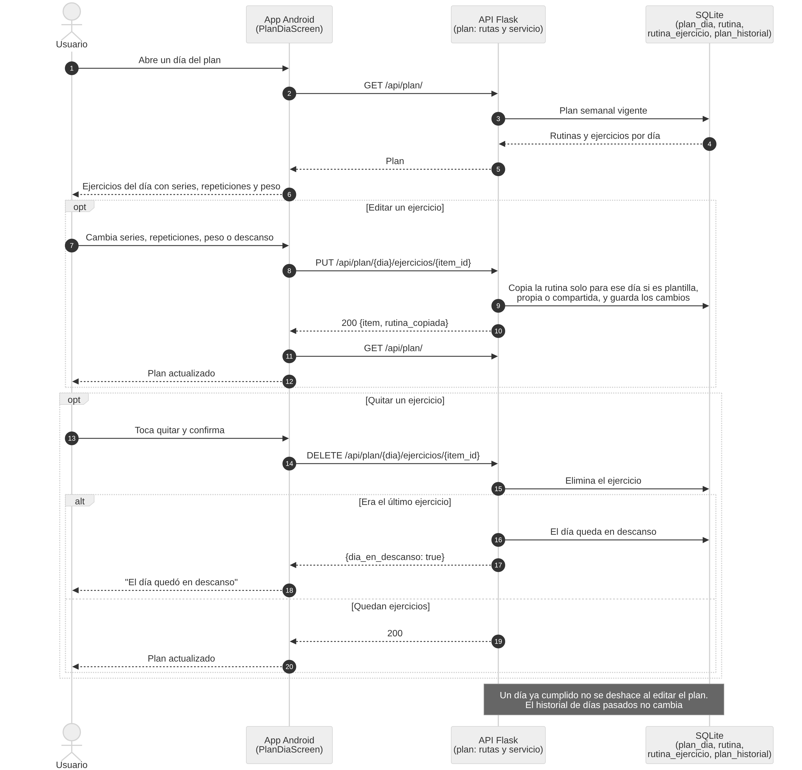
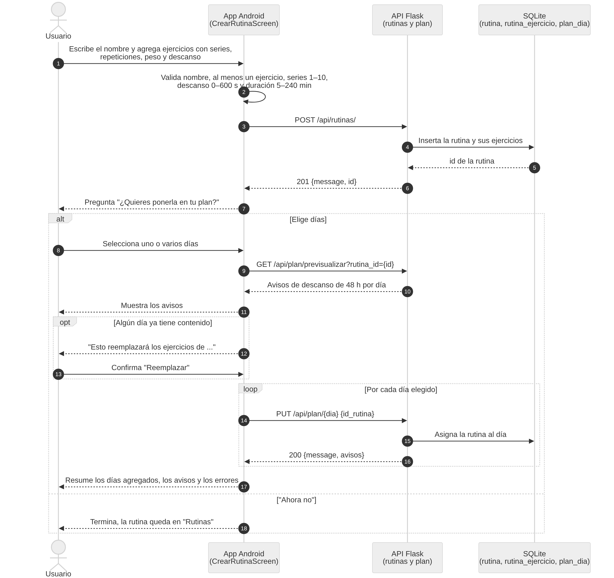
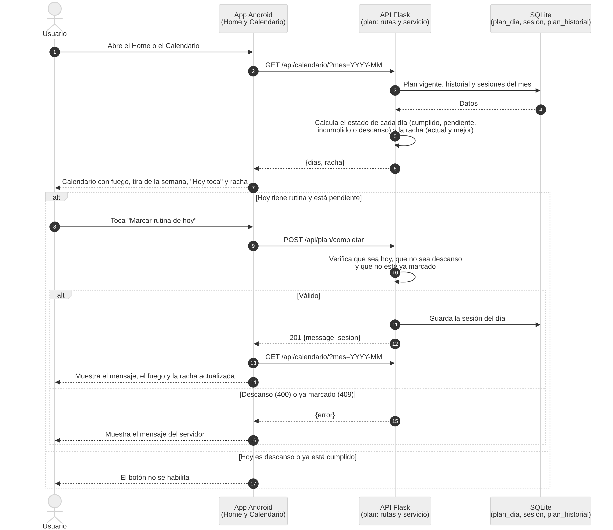

# Diagramas de secuencia

Interacción entre la app, la API y la base de datos en cada función.

> Los archivos `.mmd`, `.dot` y `.bpmn` son el **código fuente** de cada diagrama (GitHub los muestra como texto). Las imágenes están aquí abajo y en los archivos `.png`.

## SEQ-01 · Registro de usuario

Fuente: [`SEQ-01-registro-usuario.mmd`](SEQ-01-registro-usuario.mmd)

## SEQ-02 · Inicio y cierre de sesión

Fuente: [`SEQ-02-inicio-sesion.mmd`](SEQ-02-inicio-sesion.mmd)

## SEQ-03 · Administrar usuarios

Fuente: [`SEQ-03-administrar-usuarios.mmd`](SEQ-03-administrar-usuarios.mmd)

## SEQ-04 · Explorar el catálogo

Fuente: [`SEQ-04-explorar-catalogo.mmd`](SEQ-04-explorar-catalogo.mmd)

## SEQ-05 · Recomendación personalizada

Fuente: [`SEQ-05-recomendacion-personalizada.mmd`](SEQ-05-recomendacion-personalizada.mmd)

## SEQ-06 · Agregar un ejercicio al plan

Fuente: [`SEQ-06-agregar-ejercicio-al-plan.mmd`](SEQ-06-agregar-ejercicio-al-plan.mmd)

## SEQ-07 · Editar el plan del día

Fuente: [`SEQ-07-editar-plan-del-dia.mmd`](SEQ-07-editar-plan-del-dia.mmd)

## SEQ-08 · Crear una rutina y asignarla

Fuente: [`SEQ-08-crear-rutina-y-asignar.mmd`](SEQ-08-crear-rutina-y-asignar.mmd)

## SEQ-09 · Marcar el día cumplido y la racha

Fuente: [`SEQ-09-marcar-dia-cumplido-y-racha.mmd`](SEQ-09-marcar-dia-cumplido-y-racha.mmd)
